<p>
<picture>
  <source media="(prefers-color-scheme: light)" srcset="assets/banner/hero-v2-light.svg">
  
</picture>
</p>

<p>
<picture>
  <source media="(prefers-color-scheme: light)" srcset="assets/readme/lead-v2-light.svg">
  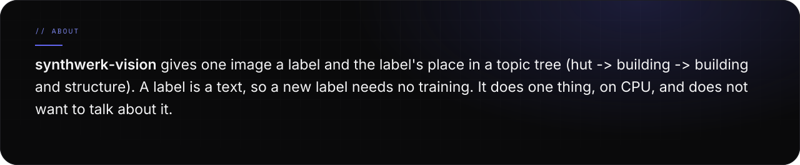
</picture>
</p>

<p>
<picture>
  <source media="(prefers-color-scheme: light)" srcset="assets/readme/stats-v2-light.svg">
  
</picture>
</p>

<br>

<p>

</p>

<p>
<picture>
  <source media="(prefers-color-scheme: light)" srcset="assets/readme/features-v2-light.svg">
  
</picture>
</p>

<p>
<picture>
  <source media="(prefers-color-scheme: light)" srcset="assets/readme/what-v2-light.svg">
  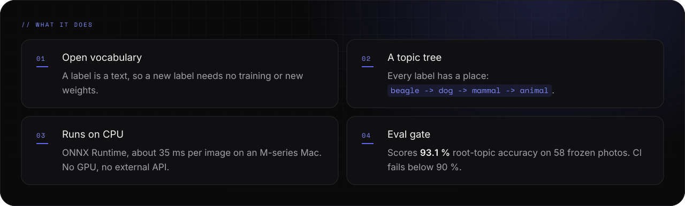
</picture>
</p>

<br>

<p>

</p>

<p>
<picture>
  <source media="(prefers-color-scheme: light)" srcset="assets/readme/start-v2-light.svg">
  
</picture>
</p>

<p>
<picture>
  <source media="(prefers-color-scheme: light)" srcset="assets/readme/setup-v2-light.svg">
  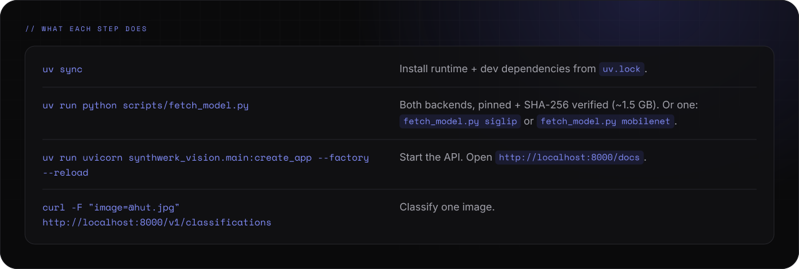
</picture>
</p>

<p>
<picture>
  <source media="(prefers-color-scheme: light)" srcset="assets/readme/startnotes-v2-light.svg">
  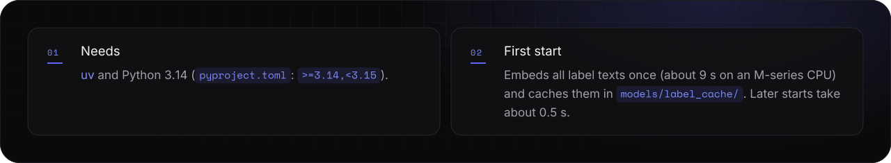
</picture>
</p>

<p>
<picture>
  <source media="(prefers-color-scheme: light)" srcset="assets/readme/docker-v2-light.svg">
  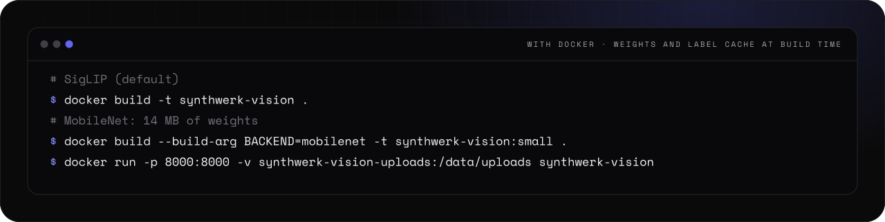
</picture>
</p>

<details>
<summary><picture><source media="(prefers-color-scheme: light)" srcset="assets/readme/links-7-v2-light.svg"></picture></summary>

```bash
uv sync                                  # install runtime + dev dependencies from uv.lock
uv run python scripts/fetch_model.py     # both backends, pinned + SHA-256 verified (~1.5 GB)
                                         # or: fetch_model.py siglip | fetch_model.py mobilenet
uv run uvicorn synthwerk_vision.main:create_app --factory --reload
```

```bash
curl -F "image=@hut.jpg" http://localhost:8000/v1/classifications
```

```bash
docker build -t synthwerk-vision .                                     # SigLIP (default)
docker build --build-arg BACKEND=mobilenet -t synthwerk-vision:small . # 14 MB of weights
docker run -p 8000:8000 -v synthwerk-vision-uploads:/data/uploads synthwerk-vision
```

</details>

<p align="center">
<a href="https://docs.astral.sh/uv/"><picture><source media="(prefers-color-scheme: light)" srcset="assets/readme/links-1-v2-light.svg">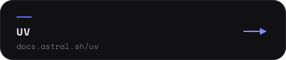</picture></a>
<a href="http://localhost:8000/docs"><picture><source media="(prefers-color-scheme: light)" srcset="assets/readme/links-2-v2-light.svg">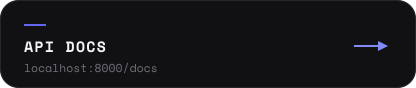</picture></a>
<a href=".env.example"><picture><source media="(prefers-color-scheme: light)" srcset="assets/readme/links-3-v2-light.svg"></picture></a>
</p>

<br>

<p>

</p>

<p>
<picture>
  <source media="(prefers-color-scheme: light)" srcset="assets/readme/flow-v2-light.svg">
  
</picture>
</p>

<p>
<picture>
  <source media="(prefers-color-scheme: light)" srcset="assets/readme/how-v2-light.svg">
  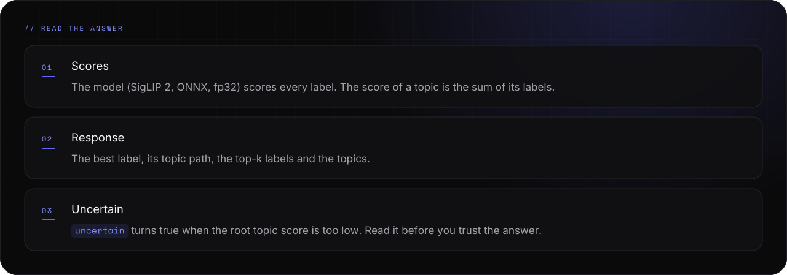
</picture>
</p>

<br>

<p>

</p>

<p>
<picture>
  <source media="(prefers-color-scheme: light)" srcset="assets/readme/api-v2-light.svg">
  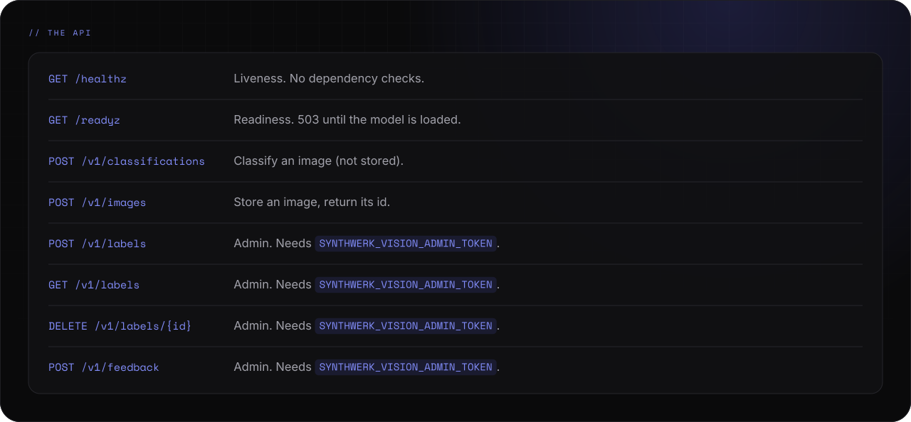
</picture>
</p>

<p>
<picture>
  <source media="(prefers-color-scheme: light)" srcset="assets/readme/backends-v2-light.svg">
  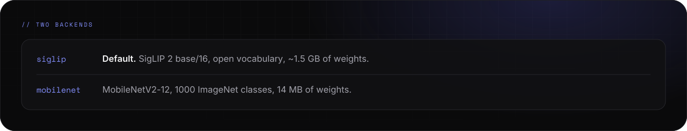
</picture>
</p>

<p>
<picture>
  <source media="(prefers-color-scheme: light)" srcset="assets/readme/config-v2-light.svg">
  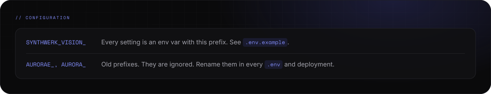
</picture>
</p>

<p>
<picture>
  <source media="(prefers-color-scheme: light)" srcset="assets/readme/reference-v2-light.svg">
  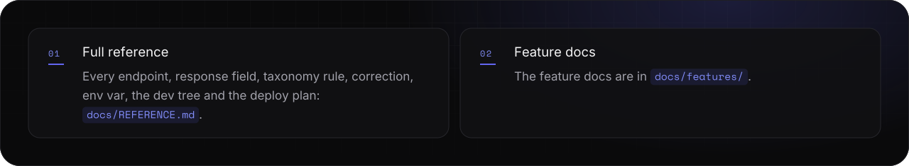
</picture>
</p>

<p align="center">
<a href="docs/REFERENCE.md"><picture><source media="(prefers-color-scheme: light)" srcset="assets/readme/links-4-v2-light.svg"></picture></a>
<a href="docs/features/"><picture><source media="(prefers-color-scheme: light)" srcset="assets/readme/links-5-v2-light.svg"></picture></a>
<a href="LICENSE"><picture><source media="(prefers-color-scheme: light)" srcset="assets/readme/links-6-v2-light.svg"></picture></a>
</p>

<br>

<p>

</p>

<p>
<picture>
  <source media="(prefers-color-scheme: light)" srcset="assets/readme/status-v2-light.svg">
  
</picture>
</p>

<p>
<picture>
  <source media="(prefers-color-scheme: light)" srcset="assets/readme/now-v2-light.svg">
  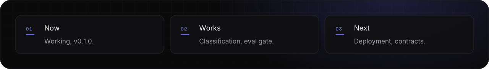
</picture>
</p>

<p>
<picture>
  <source media="(prefers-color-scheme: light)" srcset="assets/readme/checks-v2-light.svg">
  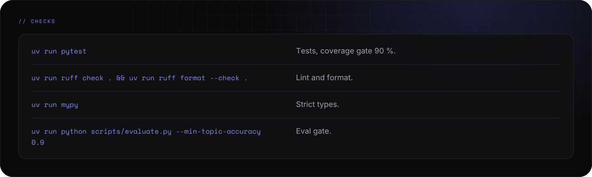
</picture>
</p>

<details>
<summary><picture><source media="(prefers-color-scheme: light)" srcset="assets/readme/links-7-v2-light.svg"></picture></summary>

```bash
uv run pytest                                              # tests, coverage gate 90 %
uv run ruff check . && uv run ruff format --check .        # lint and format
uv run mypy                                                # strict types
uv run python scripts/evaluate.py --min-topic-accuracy 0.9 # eval gate
```

</details>

<p>
<picture>
  <source media="(prefers-color-scheme: light)" srcset="assets/readme/footer-v2-light.svg">
  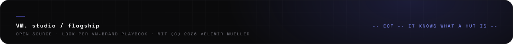
</picture>
</p>
