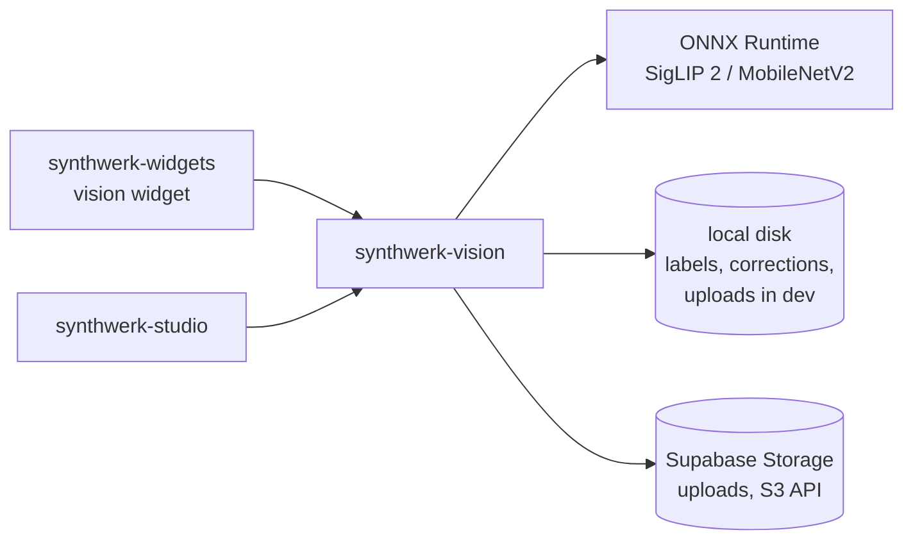

# synthwerk-vision — reference

Everything from the v1 README that did not fit the v2 front page. Commands, flags, env
vars and links here are the source of truth; the README only condenses them.

## Where it fits



- Ecosystem map: [synthwerk](https://github.com/VelimirMueller/synthwerk).

## API and events

- API spec: FastAPI serves it at `/docs` and `/openapi.json`. The admin routes of the org label sets are in [synthwerk-contracts](https://github.com/VelimirMueller/synthwerk-contracts) `openapi/vision/openapi.yaml` (synthwerk#44). The other routes follow.
- Events: none yet.

| Method | Path                  | Purpose                                     | Success | Errors        |
|--------|-----------------------|---------------------------------------------|---------|---------------|
| GET    | `/healthz`            | Liveness: the process runs (no checks)      | 200     |               |
| GET    | `/readyz`             | Readiness: `model` check (+ `data_dir` with admin on, + `storage` with the s3 backend) | 200 | 503 |
| POST   | `/v1/images`          | Store an image for the token's org, return its generated id | 201 | 401, 403, 413, 415, 422, 503, 507 |
| POST   | `/v1/classifications` | Classify an image (not stored)              | 200     | 401, 403, 413, 415, 422, 503 |
| *admin* | `/v1/labels`, `/v1/feedback` | See [Runtime labels and corrections](#runtime-labels-and-corrections) | | 401, 404, 409 |
| *admin* | `/v1/orgs/{org_id}/labels`, `/v1/orgs/{org_id}/feedback` | Label set and corrections of one org, see [Label sets per org](features/label-sets.md) | | 401, 404, 409, 422 |

- `/healthz` and `/readyz` follow the Synthwerk health contract (`openapi/_shared/health.yaml` in
  synthwerk-contracts). `/health` is gone (#23).
- `/readyz` answers `{status, version, commit, checks[{name, status, latency_ms, detail}]}`.
  `status` is the worst check: `ok` and `degraded` answer 200, `down` answers 503.
  - `model`: `down` until the model is loaded.
  - `data_dir`: only when `SYNTHWERK_VISION_ADMIN_TOKEN` is set. `degraded` when the data
    directory is not writable (classification still works, runtime labels and corrections fail).
  - `storage`: only with `SYNTHWERK_VISION_STORAGE_BACKEND=s3`. `degraded` when the upload bucket
    does not answer within 0.4 s (check timeout 0.45 s), is missing or refuses the credentials (uploads fail with 503).
- Both POST endpoints take `multipart/form-data` with one field, `image` (JPEG, PNG or WebP).
- Both POST endpoints need `Authorization: Bearer <widget token>` from synthwerk-identity and the
  matching `Origin` header (#76). No valid token: 401. Other origin: 403. See
  [Widget token](docs/features/widget-token-auth.md).

Example: a photo of a wooden hut in a rice field (real output, `top_k=3`, ids shortened):

```json
{
  "request_id": "da71efe1…",
  "image": { "sha256": "99645f6c6ed4…", "content_type": "image/jpeg", "size_bytes": 149115, "width": 960, "height": 480 },
  "model": { "name": "siglip2-base-patch16-224", "taxonomy_version": 1 },
  "primary": {
    "id": "open:hut", "label": "hut", "score": 0.3229,
    "topic": "building", "path": ["building and structure", "building", "hut"]
  },
  "topic": { "id": "building and structure", "parent": null, "depth": 0, "score": 0.815 },
  "labels": [
    { "id": "open:hut", "label": "hut", "score": 0.3229, "topic": "building", "path": ["building and structure", "building", "hut"] },
    { "id": "n02859443", "label": "boathouse", "score": 0.1376, "topic": "building", "path": ["…"] },
    { "id": "n02793495", "label": "barn", "score": 0.1131, "topic": "building", "path": ["…"] }
  ],
  "topics": [
    { "id": "building and structure", "parent": null, "depth": 0, "score": 0.815 },
    { "id": "building", "parent": "building and structure", "depth": 1, "score": 0.7964 },
    { "id": "landscape", "parent": null, "depth": 0, "score": 0.1428 }
  ],
  "uncertain": false,
  "timings_ms": { "inference": 31.45, "rollup": 0.14, "total": 35.72 }
}
```

Spot checks on six Wikimedia Commons photos (2026-10-02); the real numbers are in
[Evaluation](#evaluation):

| Photo | `primary.path` (label score) | `topic` |
|---|---|---|
| Labrador | animal › mammal › dog › Labrador retriever (0.89) | animal 0.99 |
| Cat in snow | animal › mammal › cat › tabby (0.43) | animal 0.99 |
| Bicycle | vehicle › bicycle › bicycle-built-for-two (0.94, wrong leaf) | vehicle 0.98 |
| Wooden hut | building and structure › building › hut (0.32) | building and structure 0.82 |
| Skyscraper | building and structure › building › skyscraper (0.58) | building and structure 0.99 |
| Aurora (a painting) | landscape › sky › aurora borealis (0.57) | landscape 0.65 |

| Field | Meaning |
|---|---|
| `primary` | The most likely label, with the path from its root topic |
| `topic` | The most likely root ("meta") topic, such as `animal`, `vehicle` or `building and structure` |
| `labels` | Top-k labels (`SYNTHWERK_VISION_TOP_K`) |
| `topics` | Every topic scoring at least `SYNTHWERK_VISION_TOPIC_MIN_SCORE`, best first |
| `uncertain` | `true` when the root topic score is below `SYNTHWERK_VISION_UNCERTAIN_BELOW` |
| `correction` | An admin correction for this picture, or `null` (see [Runtime labels and corrections](#runtime-labels-and-corrections)) |

Every response, errors included, carries an `X-Request-ID` header. A caller-supplied
`X-Request-ID` is kept when it is 1–64 characters of `[A-Za-z0-9_.-]`; otherwise the server
generates one. Classification responses repeat it as `request_id`.

## Taxonomy

Two packaged taxonomies, one per backend:

| File | Backend | Topics | Labels |
|---|---|---|---|
| [`taxonomy_open.yaml`](src/synthwerk_vision/data/taxonomy_open.yaml) | `siglip` | 57 (22 roots) | 1068: extends the ImageNet file with 68 more |
| [`taxonomy.yaml`](src/synthwerk_vision/data/taxonomy.yaml) | `mobilenet` | 53 (20 roots) | 1000, `index` = model output |

```yaml
topics:
  - {id: building, parent: building and structure}
labels:
  - {id: n03793489, name: mouse, topic: electronics, index: 673}
```

`taxonomy_open.yaml` does not repeat the 1000 ImageNet labels. It `extends`
`taxonomy.yaml` and adds `prompts`, 4 topics and 68 labels. Your own file can do the same,
which is the easiest way to add labels: a few lines on top of the packaged tree.

```yaml
# my-taxonomy.yaml, used with SYNTHWERK_VISION_TAXONOMY_PATH=my-taxonomy.yaml
extends: package:taxonomy_open.yaml
topics:
  - {id: aurora photo, parent: sky}
labels:
  - {id: my:corona, name: aurora corona, topic: aurora photo}
```

`extends` takes `package:<file>` or a path relative to the extending file, up to 4 levels.
Extending labels get their `index` automatically (after the base labels), and `prompts` may
only name labels that exist.

For SigLIP, a label is scored by the text `this is a photo of a {prompt or name}.`. The
`prompt` field disambiguates names a text model would misread ("mouse" is the computer
mouse). Every label text must be unique, or two labels get the same embedding.

`scripts/build_taxonomy.py` generates both files from WordNet: each ImageNet label goes
under the topic whose WordNet anchor is its *closest* hypernym. Its `TOPICS`, `OVERRIDES`,
`PROMPTS` and `OPEN_LABELS` tables are the source of truth: edit them and rerun. For your
own deployment you can also edit a copy of the YAML and set `SYNTHWERK_VISION_TAXONOMY_PATH`. On startup the service checks the tree
(unknown parents, cycles, duplicate ids, gaps in the indices, label count against the model's
outputs) and refuses to start if it is broken. This holds even when the model is missing: a
missing model is an ops state (503), while a broken taxonomy is a config bug.
If the model files are missing, the service still starts: `/readyz` reports `down` (503)
and classification returns 503.

### Backends

| `SYNTHWERK_VISION_BACKEND` | Model | Labels | Inference (CPU) | Weights |
|---|---|---|---|---|
| `siglip` (default) | SigLIP 2 base/16, 224 px, fp32 image and text towers | any text | ~30 ms | ~1.5 GB |
| `mobilenet` | MobileNetV2-12 | 1000 ImageNet classes | ~5 ms | 14 MB |

The build-time label cache covers the packaged taxonomy. With a custom
`SYNTHWERK_VISION_TAXONOMY_PATH`, the first container start embeds its labels (seconds) into
`SYNTHWERK_VISION_LABEL_CACHE_DIR`, so mount that directory as a volume to keep the cache across restarts.
The text tower runs only when label texts change (a cache miss): about 9 s for 1068 labels
with a ~3.2 GB memory peak (the fp32 Gemma vocabulary table alone is 786 MB), and then it is
dropped. Docker images ship with the cache built, so containers never load it unless you use a
custom taxonomy. In that case, give the first start about 4 GB of memory and mount the cache
directory. The SigLIP image is 3.48 GB. The container is ready in 1.3 s
(label cache built in) and uses ~790 MiB of RAM after the first classification (measured
2026-10-05, Docker 29.4 on an M-series Mac).

Both towers are **fp32 on purpose**:
- In a spike, the int8 image tower misread an aurora painting as a boat.
- The int8 text tower is accurate on ARM (cosine 0.996 to fp32) but not on x86 servers
  without VNNI (mean 0.959, min 0.872). On the x86 CI runner that dropped root-topic accuracy
  from 93.1 % to 83.0 %.
- fp32 gives identical embeddings on every architecture.

## Runtime labels and corrections

The admin endpoints change what the server knows while it runs. They need
`Authorization: Bearer $SYNTHWERK_VISION_ADMIN_TOKEN` and **do not exist (404) when no token is set**.
The routes below change the **default label set**. Each org can have its own set and its own
corrections under `/v1/orgs/{org_id}/…` (synthwerk#44): see
[Label sets per org](features/label-sets.md). The studio BFF calls those routes with the
admin token after it checked that the user is an owner or admin of the org.

| Method | Path | Does |
|---|---|---|
| `POST` | `/v1/labels` | Add a text label: `{"name", "topic", "prompt"?, "new_topic"?, "topic_parent"?}` |
| `GET` | `/v1/labels` | List runtime labels |
| `DELETE` | `/v1/labels/{id}` | Remove a runtime label (packaged labels cannot be removed: 409) |
| `POST` | `/v1/feedback` | `image` + `label_id`: the correct label for this picture |

```bash
curl -H "Authorization: Bearer $SYNTHWERK_VISION_ADMIN_TOKEN" -H 'content-type: application/json' \
  -d '{"name": "rice paddy", "topic": "landscape", "prompt": "a green rice paddy field"}' \
  http://localhost:8000/v1/labels
```

- **No retraining.** A new label is one more text to embed; known texts keep their cached
  embedding. Adding a label takes about 30 s on CPU, mostly loading the fp32 text tower, which
  is dropped afterwards. The running service keeps answering meanwhile. The new service is
  built completely and then swapped in with one assignment, so no request sees a half-updated
  model.
- **Persistence.** The default set lives in `$SYNTHWERK_VISION_DATA_DIR/label-sets/default.yaml`, an
  ordinary taxonomy file that `extends` the configured base. Org sets live in
  `label-sets/orgs/<org id>.yaml`. Startup moves the `labels.yaml` of older versions to the default set. It survives restarts and can be reviewed and edited.
  A change is staged and validated first; a failed change leaves file and service as they were.
- **Corrections** are stored in `$SYNTHWERK_VISION_DATA_DIR/feedback.sqlite3`, keyed by the picture's
  difference hash and the org. `POST /v1/feedback` writes a default correction; an org gets its own
  correction first, then a default one, never one of another org. When the same picture comes back (re-encoded or resized), the response
  carries `correction` next to the unchanged model output. Clients should prefer it.
  Different photos are never affected. Semantic embeddings cannot do this safely: on the eval
  set a resized copy of one photo can be *less* similar (0.87) than two different photos (0.90).
  Generalising from corrections (few-shot prototypes) is future work.
- Runtime labels need an open-vocabulary backend; `mobilenet` answers 409.

## Evaluation

[`eval/manifest.yaml`](eval/manifest.yaml) is a frozen set of **58 freely licensed Wikimedia
Commons photos** across 17 root topics. Every entry records the source page, author, license
and SHA-256. Images were picked by search query and license only, never by model output, then
checked by eye. Mixed images accept more than one topic (a girl hugging her dog: `person` or
`animal`). The metric is **root-topic top-1 accuracy**: is `topic` one of the accepted topics?

| Backend | Root-topic accuracy | 95 % interval (Wilson) | In top 3 | Latency/image |
|---|---|---|---|---|
| `siglip` | **93.1 %** (54/58) | 83.6–97.3 % | 98.3 % | 32 ms (M-series), 227 ms (4-vCPU x86 CI runner) |
| `mobilenet` | 70.7 % (41/58) | 58.0–80.8 % | 84.5 % | 7 ms (M-series) |

Measured 2026-10-03. SigLIP scores the same on ARM (M-series) and x86 (GitHub runner), with the
same four misses. That took the fp32 text tower: with int8 it fell to 83.0 % on x86 (see
[Backends](#backends)). Latency depends heavily on the CPU. The intervals do not overlap, so the difference holds
even on 58 images. CI runs the eval on every PR and on pushes to `main` and fails below 90 % for SigLIP. The
report is in the job summary.

```bash
uv run python scripts/evaluate.py                         # siglip
SYNTHWERK_VISION_BACKEND=mobilenet uv run python scripts/evaluate.py
```

What the misses show:
- **The catch-all bias of summed scores.** A sunflower became `object` although its top label
  was `daisy` (a plant). ImageNet has no sunflower, so probability spread across many weak
  labels, and the 113-label `object` topic collected more of it than `plant`. Broader label
  coverage fixes this better than any score trick. It is **not** patched here, because tuning
  the taxonomy on eval misses would make the eval meaningless.
- **Defensible disagreements**: a marina → `dock`, a waterfall with a dam → `dam`.
- MobileNet reads painted portraits as clothing and maps as jigsaw puzzles (1.00). Those are
  the limits of a closed 1000-class model.

Images are cached in `eval/images/` (in CI: an Actions cache keyed by the manifest). Wikimedia
renders thumbnails per data centre, so GitHub's runners receive other JPEG bytes for 5 of the 58
pictures than a client in Europe. Every entry therefore carries both a SHA-256 and a 64-bit
difference hash. A download is accepted when the bytes match, or when the dHash is within 8 bits
(re-encodes differ by at most 6, distinct images by at least 15). Re-encoded images are listed in
the report. Downloads are paced and retried on 429/5xx. Anything else, such as a deleted file,
is reported as *unavailable* with its reason, and the gate fails once more than 10 % are
unavailable. The fix is then to rebuild the set: `scripts/build_eval_manifest.py
--force` followed by a new visual review, because Commons search order drifts between runs.

## Configuration

- All settings are environment variables with the prefix `SYNTHWERK_VISION_`. See [`.env.example`](.env.example).
- **Env vars with any other prefix are ignored.** This includes the prefixes of the old project name. Rename them in every `.env` and deployment.
- A bare `SYNTHWERK_` prefix (without `VISION_`) is also ignored. Each Synthwerk service has its own prefix.
- The service does not warn about old names. It uses the default value instead.
- Names only. Secret values (`SYNTHWERK_VISION_ADMIN_TOKEN`, the S3 keys) live in the environment or in a mounted file, never in the repo.

| Variable                     | Default                                        |
|------------------------------|------------------------------------------------|
| `SYNTHWERK_VISION_CORS_ORIGINS`     | `["http://localhost:5173","http://localhost:8080"]`: JSON list of first-party origins for the widget routes. `scheme://host[:port]`, `http` only for localhost; an invalid item (also `*`) stops the start |
| `SYNTHWERK_VISION_IDENTITY_URL`     | unset: widget CORS uses `CORS_ORIGINS` only. Identity base URL, e.g. `http://identity:8080`; asked which customer origins an app lists (cached 60 s) |
| `SYNTHWERK_VISION_STORAGE_BACKEND`  | `local` (files in the upload dir) or `s3` (S3-compatible bucket) |
| `SYNTHWERK_VISION_UPLOAD_DIR`       | `uploads` (local backend)                      |
| `SYNTHWERK_VISION_UPLOAD_QUOTA_BYTES` | `1073741824` (1 GiB): bytes kept per org     |
| `SYNTHWERK_VISION_UPLOAD_QUOTA_FILES` | `10000`: files kept per org                  |
| `SYNTHWERK_VISION_UPLOAD_WRITERS` | `2`: worker processes × instances on the same store. Near a quota, usage is scanned again before each write; a quota can go over by at most writers − 1 uploads |
| `SYNTHWERK_VISION_UPLOAD_QUOTA_TOTAL_BYTES` | `5368709120` (5 GiB): bytes kept for all orgs together. Keep it below the bucket or disk size |
| `SYNTHWERK_VISION_S3_ENDPOINT`      | unset; **required** with `s3`. Supabase: `https://<project>.storage.supabase.co/storage/v1/s3`. `https` outside `local` and `ci` |
| `SYNTHWERK_VISION_S3_REGION`        | unset; **required** with `s3`, such as `eu-central-1` |
| `SYNTHWERK_VISION_S3_BUCKET`        | unset; **required** with `s3`. Keep the bucket private |
| `SYNTHWERK_VISION_S3_ACCESS_KEY_ID` / `…_FILE` | unset; **required** with `s3`: the value, or a file that holds it (not both) |
| `SYNTHWERK_VISION_S3_SECRET_ACCESS_KEY` / `…_FILE` | unset; **required** with `s3`: the value, or a file that holds it (not both) |
| `SYNTHWERK_VISION_DATA_DIR`         | `data` (runtime labels + corrections)          |
| `SYNTHWERK_VISION_ADMIN_TOKEN`      | unset: admin endpoints disabled                |
| `SYNTHWERK_VISION_OIDC_ISSUER`      | **required**: `iss` of the widget token (identity widget issuer) |
| `SYNTHWERK_VISION_JWKS_URL`         | **required**: `<identity>/.well-known/jwks.json` |
| `SYNTHWERK_VISION_OIDC_AUDIENCE`    | `synthwerk-api` (comma-separated list)         |
| `SYNTHWERK_VISION_AUTH_DISABLED`    | `false`; `true` only with env `local` or `ci` (no token on classification and upload) |
| `SYNTHWERK_VISION_MAX_UPLOAD_BYTES` | `5242880` (5 MiB)                              |
| `SYNTHWERK_VISION_MAX_IMAGE_PIXELS` | `40000000`                                     |
| `SYNTHWERK_VISION_BACKEND`          | `siglip` (or `mobilenet`)                      |
| `SYNTHWERK_VISION_SIGLIP_DIR`       | `models/siglip2-base-patch16-224`              |
| `SYNTHWERK_VISION_LABEL_CACHE_DIR`  | `models/label_cache`                           |
| `SYNTHWERK_VISION_MODEL_PATH`       | `models/mobilenetv2-12.onnx` (mobilenet)       |
| `SYNTHWERK_VISION_TAXONOMY_PATH`    | unset (packaged taxonomy for the backend)      |
| `SYNTHWERK_VISION_ORT_THREADS`      | `0` (ONNX Runtime default; spin-waiting is off) |
| `SYNTHWERK_VISION_TOP_K`            | `5`                                            |
| `SYNTHWERK_VISION_TOPIC_MIN_SCORE`  | `0.05`                                         |
| `SYNTHWERK_VISION_UNCERTAIN_BELOW`  | `0.5`                                          |
| `SYNTHWERK_VISION_LOG_LEVEL`        | `INFO` (`DEBUG`, `INFO`, `WARN`, `ERROR`)       |
| `SYNTHWERK_VISION_LOG_FORMAT`       | `json` (`console` works only when the env is `local`) |
| `SYNTHWERK_VISION_COMMIT`           | `0000000` (the image sets the build commit)    |
| `SYNTHWERK_PLATFORM_ENV`            | `local` (`local`, `ci`, `dev`, `stg`, `prd`); shared, no service prefix |

OpenTelemetry uses the `OTEL_*` names of the OTel spec, read from the process environment
(not from `.env`):

| Variable | Value |
|---|---|
| `OTEL_EXPORTER_OTLP_ENDPOINT` | Collector address, for example `http://otel-collector:4317`. Unset: no exporter, one `WARN` line. |
| `OTEL_EXPORTER_OTLP_PROTOCOL` | `grpc` |
| `OTEL_SERVICE_NAME` | `synthwerk-vision` (default) |
| `OTEL_RESOURCE_ATTRIBUTES` | `service.namespace=synthwerk,deployment.environment.name=<env>` |
| `OTEL_TRACES_SAMPLER` / `OTEL_TRACES_SAMPLER_ARG` | `parentbased_traceidratio`; `1.0` up to `stg`, `0.2` in `prd` |
| `OTEL_PYTHON_FASTAPI_EXCLUDED_URLS` | Extra URLs without spans. `/healthz` and `/readyz` are always excluded. |

## Logs and telemetry

- Logs are one JSON object per line on stdout (structlog over stdlib `logging`; uvicorn uses
  the same handler). Fields: `timestamp`, `level`, `msg`, `event.name`, `service.name`,
  `service.version`, `deployment.environment.name`, and when present `trace_id`, `span_id`,
  `synthwerk.request_id`.
- Each request writes one line `request completed` with `http.request.method`, `http.route`
  (the route template, never the raw path or query), `http.response.status_code` and
  `synthwerk.duration_ms`. `uvicorn.access` is off. `/healthz` and `/readyz` log at `DEBUG` only.
- A request that ends in an unhandled error writes the same line at `ERROR`, with status 500,
  `error.type` (the exception class) and the traceback in `exception`. The 500 response carries
  `X-Request-ID`.
- Keys such as `token`, `authorization`, `image` and `body` are dropped from every log record
  (full list: `FORBIDDEN_KEYS` in `platform/log.py`).
- With `OTEL_EXPORTER_OTLP_ENDPOINT` set, traces (FastAPI instrumentation), metrics
  (`http.server.request.duration`) and the same log records go out over OTLP/gRPC. Health
  endpoints make no spans.

## Development

```text
src/synthwerk_vision/
  main.py         app factory, widget CORS, request id + request log line, readiness checks, lifespan
  platform/config.py  pydantic-settings (prefix SYNTHWERK_VISION_, plus SYNTHWERK_PLATFORM_ENV)
  platform/log.py     JSON logs: structlog formatter, forbidden keys, request id
  platform/otel.py    OpenTelemetry resource, OTLP exporters, FastAPI instrumentation
  platform/health.py  /healthz and /readyz (health contract)
  api/routes.py   HTTP layer and dependency wiring
  api/cors.py     CORS of the widget routes: origin policy, identity lookup, middleware
  api/origin.py   strict Origin parser (same as identity)
  api/admin.py    label sets and corrections, default and per org (admin token)
  images.py       bounded reads, image validation, dHash
  storage.py      ImageStorage protocol, keys per org, local disk + S3 (obstore) backends
  classifier.py   Classifier protocol (image -> probability vector) + MobileNetV2
  siglip.py       SigLIP 2: image/text towers, tokenizer, label-embedding cache
  taxonomy.py     topic tree, label paths, roll-up of probabilities into topic scores
  runtime_labels.py  one label set: taxonomy overlay, seed copy, cross-process lock
  label_sets.py   default set + org sets on disk, migration of labels.yaml
  feedback.py     corrections in SQLite, keyed by dHash and org
  service.py      classifier + taxonomy -> labels, topics, uncertainty, timings
  evaluation.py   manifest loading, cached downloads, metrics, markdown/JSON reports
  data/taxonomy_open.yaml, data/taxonomy.yaml
scripts/fetch_model.py           pinned model download
scripts/build_taxonomy.py        regenerate both taxonomies from WordNet (dev only)
scripts/warm_label_cache.py      embed label texts ahead of time (Docker build)
scripts/evaluate.py              eval gate (root-topic accuracy, per-topic table, misses)
scripts/build_eval_manifest.py   rebuild the eval set from Commons (needs re-review)
tests/                           unit tests with fakes, real-model tests (skip without weights),
                                 test_platform.py (health contract, logs, OTel; tests/contracts/ holds
                                 a copy of the contracts health schema),
                                 rename guard (test_naming.py: the old brand name must not return)
```

| Check | Command |
|---|---|
| Tests + coverage gate (90 %) | `uv run pytest` |
| Lint and format | `uv run ruff check . && uv run ruff format --check .` |
| Types (strict) | `uv run mypy` |
| Eval gate | `uv run python scripts/evaluate.py --min-topic-accuracy 0.9` |
| Git hooks | `uv run pre-commit install` |

- Do not run two ONNX Runtime processes at once for a benchmark. They slow each other down.
- CI: [`ci.yml`](.github/workflows/ci.yml) follows the fleet standard and calls
  [`fleet-workflows@v0.0.2`](https://github.com/VelimirMueller/fleet-workflows) on pull requests:
  - `lint`: ruff check, ruff format, mypy strict, actionlint and zizmor.
  - `unit`: pytest without weights, coverage floor 90 % (`pyproject.toml`).
  - `build`: builds the MobileNet image and checks that `/readyz` answers 200
    (`scripts/docker-smoke.sh`), then builds the default SigLIP image. Nothing is pushed.
  - `model` (local job): fetches the weights, runs all tests with the real models, and runs the eval gate.
  - `e2e` runs only on demand (`workflow_dispatch` with `e2e: true`) and in `promote.yml`.
  - `conclusion` passes only when all jobs pass. It is the required check.
- [`feature-doc.yml`](.github/workflows/feature-doc.yml) calls the blueprint feature-doc check
  (`feature-doc.yml@v1`) on pull requests. A PR that changes `src/**` fails when it does not also
  change the `docs/features/<slug>.md` whose `paths:` cover the file.
  - Opt-out: label `no-feature-doc` and a line `no-feature-doc: <reason>` in the PR body.
- Dependabot watches Python, Actions and Docker dependencies.
- Exceptions to the fleet standard are in [`fleet.yml`](fleet.yml).
- Workflow runs: [ci](https://github.com/VelimirMueller/synthwerk-vision/actions/workflows/ci.yml) · [deploy](https://github.com/VelimirMueller/synthwerk-vision/actions/workflows/deploy.yml) · [promote](https://github.com/VelimirMueller/synthwerk-vision/actions/workflows/promote.yml).

### Branches

- The repo is trunk-based (decision D-04). Work on `feat/*` or `chore/*`, open a PR to `main`.
- **The `dev` branch is retired.** Do not open PRs to `dev`. CI does not run on pushes to `dev`.

## Deploy

- Every deploy starts by hand. A push, a merge or a tag deploys nothing.
- Build once, promote by digest:
  - [`deploy.yml`](.github/workflows/deploy.yml) on `develop`: build and push
    `ghcr.io/velimirmueller/synthwerk-vision:<sha>`, then deploy it to **dev**.
  - [`promote.yml`](.github/workflows/promote.yml) on `develop`, target `stg` then `prd`:
    e2e (stg only), approval, fast-forward `stage` or `main`, deploy the same image.
- Each deploy runs [`scripts/deploy/deploy.sh`](scripts/deploy/deploy.sh): resolve the digest of
  the SHA tag, SSH to the host, `docker compose up` service `vision` in `/opt/synthwerk/vision` with
  the image pinned by digest, and fail unless the running container has that digest
  ([`scripts/deploy/remote.sh`](scripts/deploy/remote.sh), the blueprint host contract).
- Secrets: one secret `DEPLOY_ENV` per environment with the lines `DEPLOY_HOST`, `DEPLOY_USER`,
  `DEPLOY_SSH_KEY_B64`, `DEPLOY_KNOWN_HOSTS_B64` (both base64 on one line) and optional
  `DEPLOY_PORT`, `DEPLOY_COMPOSE_DIR`. stg and prd need their own host or compose dir.
- Rollback: run [`redeploy.yml`](.github/workflows/redeploy.yml) with the environment and the
  previous digest. It never builds. It uses the blueprint
  [`deploy.yml`](https://github.com/VelimirMueller/synthwerk-blueprint/blob/main/.github/workflows/deploy.yml)
  and the secrets `DEPLOY_HOST`, `DEPLOY_USER`, `DEPLOY_SSH_KEY`, `DEPLOY_KNOWN_HOSTS`. It verifies
  the build provenance of the blueprint `image.yml`, so it takes only digests built before the fleet
  standard.
- Images from `deploy.yml` have no `COMMIT` build arg yet: `/readyz` reports `0000000` for them.
- Host contract: blueprint
  [`docs/conventions/deploy.md`](https://github.com/VelimirMueller/synthwerk-blueprint/blob/main/docs/conventions/deploy.md).
- Infrastructure: [synthwerk-infra](https://github.com/VelimirMueller/synthwerk-infra).

## Features

| Feature | Status |
|---|---|
| [Image classification](docs/features/image-classification.md) | stable |
| [Image upload](docs/features/image-upload.md) | beta |
| [Runtime labels](docs/features/runtime-labels.md) | beta |
| [Picture corrections](docs/features/picture-corrections.md) | beta |
| [Classification eval gate](docs/features/classification-eval.md) | stable |
| [Health and telemetry](docs/features/health-and-telemetry.md) | beta |
| [Widget token on classification and upload](docs/features/widget-token-auth.md) | beta |

## Model and data

| Item    | Source                                                                 | License      |
|---------|------------------------------------------------------------------------|--------------|
| SigLIP 2 weights + tokenizer | [google/siglip2-base-patch16-224](https://huggingface.co/google/siglip2-base-patch16-224), ONNX export by [onnx-community](https://huggingface.co/onnx-community/siglip2-base-patch16-224-ONNX) (revision `ba1f3b0`) | Apache-2.0 |
| MobileNetV2 weights | [ONNX Model Zoo, MobileNetV2-12](https://github.com/onnx/models/tree/main/validated/vision/classification/mobilenet) | Apache-2.0   |
| Labels  | [pytorch/hub `imagenet_classes.txt`](https://github.com/pytorch/hub)   | BSD-3-Clause |
| Synset ids | [Keras `imagenet_class_index.json`](https://storage.googleapis.com/download.tensorflow.org/data/imagenet_class_index.json) | Apache-2.0 |
| Eval images | 58 Wikimedia Commons files, per-file author + license in `eval/manifest.yaml` (CC BY / CC BY-SA / CC0 / public domain); not redistributed, downloaded on demand | per file |
| Topic tree | [WordNet 3.0](https://wordnet.princeton.edu/license-and-commercial-use) via NLTK | WordNet license (permissive) |

The weights were trained by their publishers (SigLIP 2 on WebLI, MobileNetV2 on
ImageNet-1k). This repository contains no
training data and no scraped images. Any future fine-tuning dataset will be documented
here with its source and license before it is used.

## Security

- Uploads are stored under `<org>/<yyyy>/<mm>/<uuid4>.<ext>`. The org comes from the widget token,
  the extension from the decoded format, never from the client. Local files open with `O_EXCL`,
  so an upload can never overwrite an existing file. S3 objects get no ACL: they stay as private
  as the bucket.
- CORS: only `POST /v1/classifications` and `POST /v1/images` answer it, for the static
  `SYNTHWERK_VISION_CORS_ORIGINS` or an origin an app lists in identity. Never credentials.
  Other routes send no CORS headers.
- Endpoints that change server state (`/v1/labels`, `/v1/feedback`) need a bearer token
  (`SYNTHWERK_VISION_ADMIN_TOKEN`, compared in constant time) and are absent without one.
- Classification and uploads need a widget token from synthwerk-identity (ES256, origin-bound,
  at most 15 min). The service does not start without the token settings, unless
  `SYNTHWERK_VISION_AUTH_DISABLED=true` in `local` or `ci`. Rate limits still need a gateway.
- `POST /v1/images` keeps at most `SYNTHWERK_VISION_UPLOAD_QUOTA_BYTES` and
  `SYNTHWERK_VISION_UPLOAD_QUOTA_FILES` per org, and at most
  `SYNTHWERK_VISION_UPLOAD_QUOTA_TOTAL_BYTES` for all orgs together. When a quota is reached, it
  answers 507 and stores nothing. Nothing deletes old uploads: free space by hand or raise the quota.
- Report a vulnerability through a private GitHub security advisory on this repo.

## Roadmap

- Few-shot labels from example images (needs calibrating image-image vs image-text scores).
- A `GET /v1/images/{id}` and a retention rule for old uploads.
- API keys and rate limiting.

## License

- [MIT](LICENSE)
